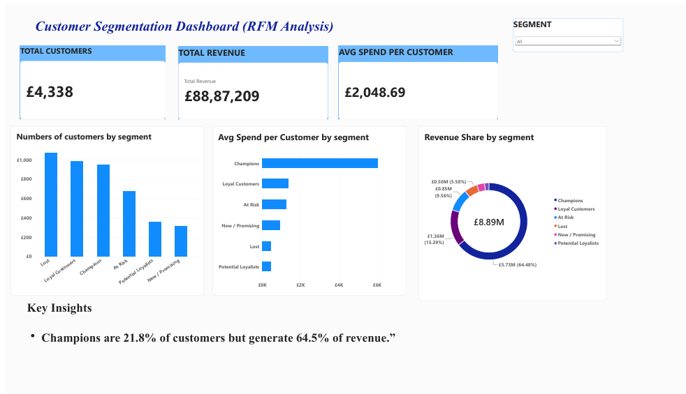

# Who Are the Customers Worth Keeping?
### RFM customer segmentation on 392,692 retail transactions

**Stack:** PostgreSQL · SQL · Python (pandas, SQLAlchemy) · Power BI



---

## The short version

A UK online retailer sends the same offers to everyone. I split its 4,338 identifiable customers into six segments based on how recently, how often and how much they buy.

> **22% of customers (Champions) bring in 64.5% of revenue.**
> Champions and Loyal customers together are 44.5% of the base and **79.8% of revenue**.

The best place to spend win-back budget is the **At Risk** group, not the Lost group.

---

## The business question

How should a retailer split its marketing budget when customers are very different in value?

Sending one offer to everyone wastes money on people who rarely buy, and under-rewards the people who keep the business running. RFM analysis gives each customer a score for:

| Letter | Measure | How I calculated it |
|---|---|---|
| **R** | Recency | Days since the customer's last order |
| **F** | Frequency | Number of distinct orders |
| **M** | Monetary | Total spend (£) |

---

## What I found

| Segment | Customers | Share of customers | Revenue (£) | Share of revenue | Avg spend (£) |
|---|---|---|---|---|---|
| Champions | 947 | 21.8% | 5,730,403 | **64.5%** | ~6,051 |
| Loyal Customers | 985 | 22.7% | 1,359,260 | 15.3% | ~1,380 |
| At Risk | 670 | 15.4% | 849,783 | 9.6% | ~1,268 |
| Lost | 1,066 | 24.6% | 495,535 | 5.6% | ~465 |
| New / Promising | 312 | 7.2% | 287,385 | 3.2% | ~921 |
| Potential Loyalists | 358 | 8.3% | 164,843 | 1.9% | ~460 |

**Five things worth noticing**
1. A Champion spends about **13x** more than a Lost customer and **4.4x** more than a Loyal one.
2. The Lost group is the largest (24.6%) but adds only 5.6% of revenue.
3. At Risk customers average £1,268, close to Loyal customers, and have already spent £849,783 in total.
4. Losing even a small share of Champions would hurt more than losing all the Lost customers.
5. New / Promising customers already spend about £921 each, which is a strong start.

---

## What I would do about it

| Segment | Action | Why |
|---|---|---|
| Champions | Early access, loyalty rewards, referral program | Protect the revenue core |
| Loyal Customers | Bundles and upsell offers | There is a 4.4x spend gap to Champions |
| At Risk | Personalized win-back email with a time-limited offer | Best return on marketing spend |
| New / Promising | Welcome series and second-purchase offer | Convert early momentum into habit |
| Potential Loyalists | Product recommendations | Low-cost way to raise frequency |
| Lost | One cheap reactivation email, then stop | Low value per customer |

---

## How I built it

```
CSV  →  Python loads into PostgreSQL  →  Python cleans  →  SQL builds RFM  →  Power BI dashboard
```

**1. Load.** `Data/Load_data.py` reads the CSV, fixes data types and writes 541,909 rows to the `online_retail` table.

**2. Clean.** `Data/Clean_data.py` produces the `retail_clean` table:

| Step | Rows left | Removed |
|---|---|---|
| Raw data | 541,909 | n/a |
| Missing Customer ID | 406,829 | 135,080 |
| Cancelled orders (invoice starts with "C") | 397,924 | 8,905 |
| Zero or negative quantity or price | 397,884 | 40 |
| Duplicate rows | 392,692 | 5,192 |

It also adds `total_price = quantity × unit_price`. Rows with no Customer ID can't be tracked across orders, so they can't be segmented.

**3. Score.** `sql/rfm_queries.sql` builds `rfm`, `rfm_scores` and `rfm_segments`. Each metric gets a 1–5 score with `NTILE(5)`, and segment rules are applied on the scores.

**4. Visualize.** The Power BI dashboard (`dashboard/customer_segmentation.pbix`) shows KPI cards, segment size, revenue share, average spend, and an insight table.

---

## Data

- **Online Retail dataset** (UCI Machine Learning Repository / Kaggle)
- UK online retailer, 1 Dec 2010 to 9 Dec 2011
- 541,909 rows, 8 columns: InvoiceNo, StockCode, Description, Quantity, InvoiceDate, UnitPrice, CustomerID, Country
- The CSV is not included in this repository. Download it and save it as `Data/Online_Retail.csv`.

---

## Limits of this analysis

- About 25% of raw rows had no Customer ID, so the results describe identified customers only.
- The data spans roughly one year, so seasonality can affect Recency scores.
- The segment rules are my own choices. Different cutoffs would change segment sizes.
- The data is from 2010–2011 and may not match current buying behavior.

---

## Run it yourself

1. Install PostgreSQL and create a database called `retail_db`.
2. Install packages:
   ```
   pip install pandas sqlalchemy psycopg2-binary matplotlib python-dotenv
   ```
3. Download the dataset and save it as `Data/Online_Retail.csv`.
4. Copy `.env.example` to `.env` and fill in your PostgreSQL password and port.
5. Run `Data/Load_data.py`, then `Data/Clean_data.py`.
6. Run the queries in `sql/rfm_queries.sql` in pgAdmin.
7. Run `Data/rfm.py` for the segment summary, or open the `.pbix` file in Power BI Desktop.

---

## Repository layout

```
├── Data/
│   ├── Load_data.py
│   ├── Clean_data.py
│   └── rfm.py
├── sql/
│   └── rfm_queries.sql
├── dashboard/
│   ├── customer_segmentation.pbix
│   ├── dashboard.png
│   ├── segments.png
│   └── Figure_1.png
├── .env.example
├── .gitignore
└── README.md
```

---

**Shweta Dhurve** · [LinkedIn](https://linkedin.com/in/your-profile) · [GitHub](https://github.com/shwetadhurve588-wq)
