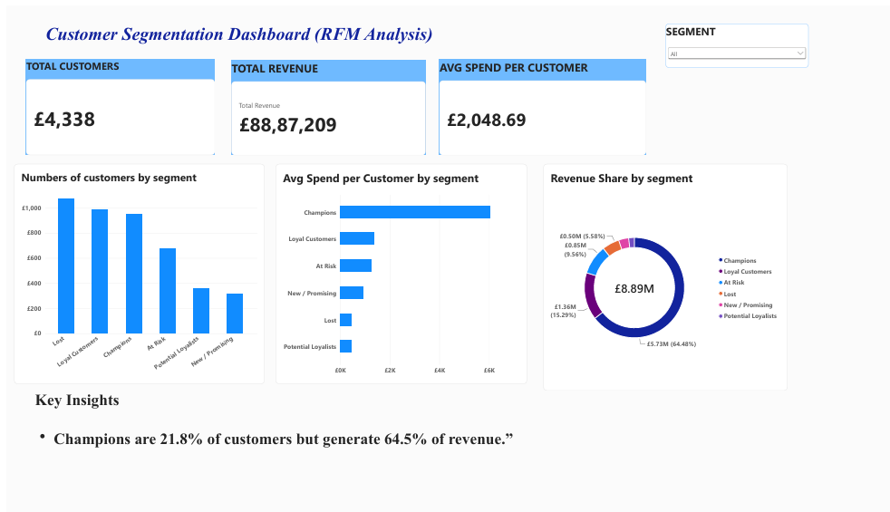

# Customer Segmentation using RFM Analysis (PostgreSQL, Python, Power BI)

## Business Summary
An online retailer sends the same offers to every customer. This wastes marketing budget on customers who rarely buy and under-rewards the ones who bring in most of the revenue.

I segmented **4,338 customers** using RFM analysis (Recency, Frequency, Monetary value). The result: **21.8% of customers (Champions) generate 64.5% of revenue**. The business should protect this group first, then win back "At Risk" customers, who are the best return on marketing spend.

## Problem Statement
An online retailer treats all customers the same, sending identical offers to everyone. This project segments customers using RFM analysis on transaction data so the business can target high-value customers, win back at-risk ones, and spend marketing budget more efficiently.

## Dashboard


## Tools Used
- **PostgreSQL**: data storage, RFM calculation and segmentation (SQL)
- **Python** (pandas, SQLAlchemy, psycopg2, matplotlib): data loading and cleaning
- **Power BI**: one-page dashboard

## Data Source
- **Online Retail dataset** (UCI Machine Learning Repository / Kaggle)
- UK-based online retailer, transactions from **1 Dec 2010 to 9 Dec 2011**
- 541,909 rows, 8 columns

| Column | Meaning |
|---|---|
| InvoiceNo | Invoice number (starts with "C" if cancelled) |
| StockCode | Product code |
| Description | Product name |
| Quantity | Units per transaction |
| InvoiceDate | Date and time of the transaction |
| UnitPrice | Price per unit (£) |
| CustomerID | Unique customer ID |
| Country | Customer's country |

## Data Cleaning Log

| Step | Rows left | Rows removed |
|---|---|---|
| Raw data | 541,909 | - |
| Removed rows with missing Customer ID | 406,829 | 135,080 |
| Removed cancelled orders (invoice starts with "C") | 397,924 | 8,905 |
| Removed zero or negative quantity or price | 397,884 | 40 |
| Removed duplicate rows | 392,692 | 5,192 |

**Final clean dataset: 392,692 rows (72.5% of the raw data).**

Other steps: converted `InvoiceDate` to datetime, converted `CustomerID` to integer, and created `total_price = quantity x unit_price`.

Customers without an ID cannot be tracked across orders, so they cannot be segmented.

## Method
1. **Load** the raw CSV into PostgreSQL with Python (`Load_data.py`).
2. **Clean** the data in Python and save it as the `retail_clean` table (`Clean_data.py`).
3. **Calculate RFM** per customer in SQL:
   - Recency: days since the last purchase
   - Frequency: number of distinct orders
   - Monetary: total spend
4. **Score** each metric from 1 to 5 using `NTILE(5)` (5 is best).
5. **Assign segments** with rules on the scores (see `sql/rfm_queries.sql`).
6. **Visualize** in Power BI.

## Key Insights

| Segment | Customers | % of customers | Revenue (£) | % of revenue | Avg spend (£) |
|---|---|---|---|---|---|
| Champions | 947 | 21.8% | 5,730,403 | 64.5% | ~6,051 |
| Loyal Customers | 985 | 22.7% | 1,359,260 | 15.3% | ~1,380 |
| At Risk | 670 | 15.4% | 849,783 | 9.6% | ~1,268 |
| Lost | 1,066 | 24.6% | 495,535 | 5.6% | ~465 |
| New / Promising | 312 | 7.2% | 287,385 | 3.2% | ~921 |
| Potential Loyalists | 358 | 8.3% | 164,843 | 1.9% | ~460 |

1. **Champions are 21.8% of customers but generate 64.5% of revenue.**
2. **Champions and Loyal Customers together are 44.5% of customers and 79.8% of revenue.**
3. A Champion spends about **13x more** than a Lost customer and about **4.4x more** than a Loyal customer.
4. **Lost customers are the biggest group (24.6%) but only 5.6% of revenue**, so heavy spending to win them back is poor value.
5. **At Risk customers (15.4%) have already spent £849,783** and average £1,268 each, close to a Loyal customer. They are the best win-back target.

## Recommendations

| Segment | Action |
|---|---|
| Champions | Protect first: early access, loyalty rewards, referral program |
| Loyal Customers | Upsell with bundles and offers to move them toward Champion level |
| At Risk | Personalized win-back email with a time-limited discount |
| New / Promising | Welcome series and a second-purchase offer |
| Potential Loyalists | Low-cost nudges such as product recommendations |
| Lost | Low-cost reactivation email only, or exclude to save budget |

## Limitations
- The data covers about one year, so seasonality may affect Recency scores.
- About 25% of raw rows had no Customer ID and were excluded.
- Segment rules are my own choices; different cutoffs would change segment sizes.
- The dataset is from 2010 to 2011 and may not reflect current customer behavior.

## Project Structure
```
customer_segmentation/
├── Data/
│   ├── Load_data.py
│   ├── Clean_data.py
│   └── rfm.py
├── sql/
│   └── rfm_queries.sql
├── dashboard/
│   ├── customer_segmentation.pbix
│   ├── dashboard.png
│   ├── segments.png
│   └── Figure_1.png
├── .env.example
├── .gitignore
└── README.md
```

## How to Run
1. Install PostgreSQL and create a database named `retail_db`.
2. Install packages: `pip install pandas sqlalchemy psycopg2-binary matplotlib python-dotenv`
3. Download the dataset (Online Retail, UCI or Kaggle) and save it as `Data/Online_Retail.csv`.
4. Copy `.env.example` to `.env` and enter your PostgreSQL password and port.
5. Run `Data/Load_data.py`, then `Data/Clean_data.py`.
6. Run the queries in `sql/rfm_queries.sql` in pgAdmin.
7. Run `Data/rfm.py` for the segment summary, or open the `.pbix` file in Power BI Desktop.

## Author
Your Name | [LinkedIn](https://linkedin.com/in/your-profile) | [GitHub](https://github.com/your-username)